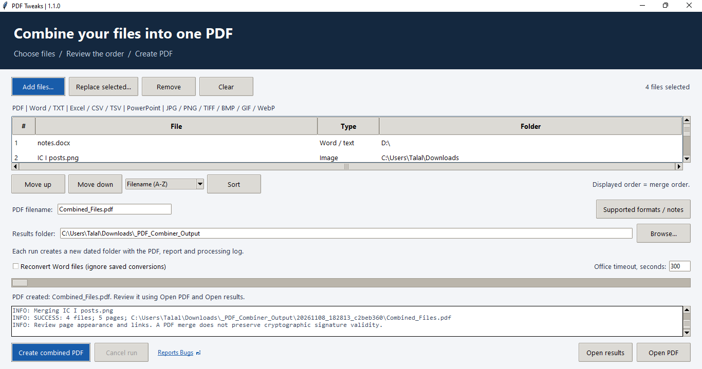

# PDF Tweaks

**Combine selected documents and images into one PDF, in the order you choose.**

[](RELEASE_NOTES.md)
[](https://www.python.org/downloads/)
[](LICENSE)

PDF Tweaks is a Python desktop application with a graphical interface and a command-line mode. Choose your files, review their order, set an output filename and confirm the merge. Each run creates a separate dated folder containing the PDF, a page-range report and a processing log.



*Interface preview on Linux with synthetic files. Office conversion requires Windows.*

## Why I built it

I regularly needed to combine PDFs, Word documents, spreadsheets and images into one file to share with colleagues. Preparing those files individually took time and effort. I created PDF Tweaks to bring selection, ordering and conversion into one practical workflow.

## Features

- Add files from multiple folders; replace, remove or reorder items in the queue.
- Choose alphabetical or natural filename sorting, including `2` before `10`.
- Set the output PDF filename and results folder.
- Convert supported Office documents through the corresponding installed desktop applications.
- Place images on portrait or landscape A4 pages, including every frame of multi-frame images.
- Reuse validated Word conversions; saved changes to a source file trigger another conversion.
- View progress, request cancellation and retain earlier result folders.
- Use the same conversion pipeline from the graphical interface or command line.
- Open the author's GitHub profile from the **Report Bugs ↗** footer link.

## Supported inputs

| Input | Extensions | Requirement |
| --- | --- | --- |
| PDF | `.pdf` | Python packages |
| Word / text | `.doc`, `.docx`, `.docm`, `.rtf`, `.odt`, `.txt` | Windows and desktop Microsoft Word |
| Excel / data | `.xls`, `.xlsx`, `.csv`, `.tsv` | Windows and desktop Microsoft Excel (`.xlsm`, `.xlsb` are not working yet, `.ods` is not tested yet) |
| PowerPoint | `.ppt`, `.pptx`, `.pptm`, `.pps`, `.ppsx`, `.odp` | Windows and desktop Microsoft PowerPoint |
| Images | `.jpg`, `.jpeg`, `.png`, `.tif`, `.tiff`, `.bmp`, `.gif`, `.webp` | Python packages |

Other formats must be exported to a supported format first. Archives, executable files, audio and video are not converted into document pages.

## Install and start

Install **Python 3.11 or later** with Tcl/Tk support. Extract the source, or open your local clone, then open PowerShell in the project folder.

Create an isolated environment, install the dependencies and launch the interface. These commands do not require environment activation.

```powershell
py -m venv .venv
.\.venv\Scripts\python.exe -m pip install -r requirements.txt
.\.venv\Scripts\python.exe pdf_tweaks.py
```

1. Click **Add files** to select the documents and images to include.
2. Review the queue. Use **Move up**, **Move down**, or a sort mode followed by **Sort**.
3. Enter the **PDF filename** and choose a **Results folder** using **Browse**.
4. Click **Create combined PDF** and review the confirmation.
5. Open the result and check its appearance, links, page-range report and any warnings.

The displayed order is the merge order. Newly added files are sorted using the selected sort mode; adding more files does not automatically reorder the existing queue.

The default results location is `_PDF_Combiner_Output` under Downloads when available, otherwise Documents or the home folder. Choose a location where your account can create files and folders.

## Output files

| File | Purpose |
| --- | --- |
| Your chosen PDF filename | Combined pages in the reviewed order |
| `Merge_Report.csv` | Source filenames, conversion status, checksums, page counts and page ranges |
| `Processing_Log.txt` | Processing messages, warnings and errors |

Each run creates a new dated folder. Removing or replacing an item changes the queue; source files remain on disk. Reusable Word conversions are stored in `_Word_Cache` beneath the results directory.

If the results folder cannot be created, use **Browse** to select another location. If the normal log cannot be opened, the application attempts to save a diagnostic in the system temporary directory and displays its actual path.

## Command-line use

Run these commands from the project folder using the environment created above.

Preview supported files in a folder using natural filename order, without creating output:

```powershell
.\.venv\Scripts\python.exe pdf_tweaks.py --folder "C:\Example\Files" --list --sort natural
```

Combine specific files in the supplied order, after a confirmation prompt:

```powershell
.\.venv\Scripts\python.exe pdf_tweaks.py --files "report.pdf" "photo.png" --output-name "Document_Pack.pdf"
```

Choose the results directory and skip the confirmation after reviewing your inputs:

```powershell
.\.venv\Scripts\python.exe pdf_tweaks.py --files "first.pdf" "second.pdf" --output-dir "C:\Example\Results" --yes
```

Folder inputs use alphabetical order by default. Explicit files keep their supplied order unless `--sort` is given. Use `--recursive` with `--folder` to include subfolders, `--fresh` to reconvert Word files, and `--help` to see all options.

## Conversion notes

- Office conversion requires Windows and the relevant installed desktop application. PDF/image operations use Python packages directly and can also run on other platforms.
- Save and close source documents before conversion. Word tracked-change markup is excluded from exports.
- Excel exports visible worksheets using their existing print areas. Check Print Preview first.
- TXT, CSV and TSV files must use UTF-8 or BOM-marked UTF-16. CSV uses commas; TSV uses tabs. Data columns are imported as text to retain leading zeros, and output is fitted to one page wide.
- Every frame of a multi-frame or animated image is included as a separate page. Transparent regions are placed on a white background.
- Encrypted PDFs require an unencrypted working copy. A merged PDF does not retain the cryptographic validity of source digital signatures.
- Page-count checks do not verify visual formatting or clickable links. Review the final PDF before sharing it.

The script processes files locally. The footer link opens your browser when clicked; it does not upload selected documents. Reports and logs can contain local paths and document names, so review them before sharing.

## Tests

Run the automated suite. GUI tests are skipped unless explicitly enabled.

```powershell
.\.venv\Scripts\python.exe -m unittest discover -s tests -v
```

To include GUI tests, run the suite in a desktop session with this setting:

```powershell
$env:RUN_GUI_TESTS = "1"
.\.venv\Scripts\python.exe -m unittest discover -s tests -v
```

The suite covers selection changes, sorting, output names, PDF page order and counts, images, form fields, metadata recovery, source-change checks, Word cache reuse, output-folder failures, cancellation and simulated Office errors.

Office tests use simulated applications. Actual Word, Excel and PowerPoint conversion and formatting must also be checked on a Windows PC with those applications installed.

## Contributing

Suggestions, bug reports and pull requests are welcome. Open an [issue](https://github.com/talalondata/pdf_tweaks/issues) with the steps to reproduce a problem, the file types involved and the relevant error message. Use synthetic examples when sharing files or screenshots.

For code changes, work on a feature branch, explain the intended behavior and run the relevant tests. Keep changes focused and update the documentation when the behavior changes.

## Possible future improvements

These ideas are under consideration and are not included in this release:

| Option | Practical benefit |
| --- | --- |
| PDF page ranges | Include only the relevant pages from each PDF |
| Saved file lists | Rebuild recurring document packs |
| Image page size and margins | Choose A4 or Letter and adjust print layout |
| Drag and drop | Add files with fewer file-picker interactions |

## Support the project

If PDF Tweaks is useful to you, consider [starring the repository](https://github.com/talalondata/pdf_tweaks), [following me on GitHub](https://github.com/talalondata), sharing feedback or contributing an improvement. Thank you for supporting the project.

## License and acknowledgements

Released under the [MIT License](LICENSE).

Built with Python, Tkinter, pypdf, Pillow, ReportLab and pywin32.

- [Python Tkinter documentation](https://docs.python.org/3/library/tkinter.html)
- [pypdf merging documentation](https://pypdf.readthedocs.io/en/stable/user/merging-pdfs.html)
- [Microsoft Word PDF export](https://learn.microsoft.com/en-us/office/vba/api/word.document.exportasfixedformat)
- [Microsoft Excel PDF export](https://learn.microsoft.com/en-us/office/vba/api/excel.workbook.exportasfixedformat)
- [Microsoft PowerPoint SaveAs](https://learn.microsoft.com/en-us/office/vba/api/powerpoint.presentation.saveas)

Created with care by [Talal Faiz](https://github.com/talalondata).
